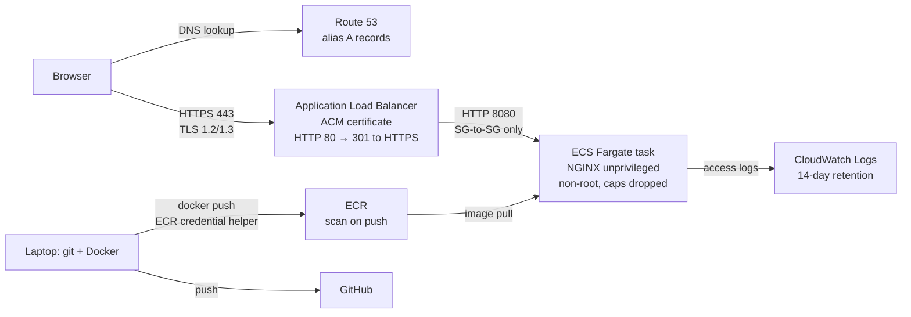

# portfolio-site

Personal portfolio site for Sean Tanner, live at **https://seantanner.dev**.

A static site served by a non-root, capability-dropped NGINX container on **AWS ECS Fargate** behind an **Application Load Balancer**, with TLS from **ACM**, DNS in **Route 53**, images in **ECR** with vulnerability scanning, and logs in **CloudWatch**. No long-lived AWS access keys exist anywhere in the workflow.

## Architecture



**Network boundary:** the load balancer's security group allows 80/443 from the internet. The task's security group allows **only port 8080, and only from the load balancer's security group**. The container is not directly reachable even though it has a public IP (used only for outbound image pulls).

## Stack

| Layer | Choice | Why |
|---|---|---|
| Content | Static HTML + CSS, no JavaScript | Smallest attack surface; allows `script-src 'none'` |
| Web server | `nginx-unprivileged` (Alpine) | Runs as non-root on port 8080 |
| Registry | Amazon ECR, scan on push | Private image storage + vulnerability scanning |
| Compute | ECS Fargate (0.25 vCPU / 0.5 GB) | No servers to patch; task-level isolation |
| Load balancer | Application Load Balancer | TLS termination, HTTP→HTTPS redirect, health checks |
| TLS | AWS Certificate Manager | Free, auto-renewing certificate, DNS-validated |
| DNS | Porkbun (registrar) → Route 53 (hosted zone) | Free-plan accounts can't register domains in Route 53; delegating DNS keeps records scriptable in AWS |
| Logs | CloudWatch Logs | Centralized access logs, 14-day retention |
| CI | GitHub Actions | Build, Trivy scan, header and non-root checks on every push and PR |
| Dependency updates | Dependabot | Weekly PRs for actions and the base image, each gated by CI |

## Hosting decision

| Option | Est. cost | Verdict |
|---|---|---|
| Lightsail containers | ~$7–10/mo | Simplest, but hides VPC, IAM and load-balancer decisions |
| EC2 + Docker | ~$5–10/mo | Cheap, but I'd own OS patching and SSH hardening |
| **ECS Fargate + ALB** | **~$35–40/mo** | **Chosen**: exposes the real decisions (network boundaries, IAM roles, TLS, health checks, logging) used in production environments |

## Request path

1. Browser resolves `seantanner.dev`. The `.dev` TLD is on the HSTS preload list, so the browser goes straight to HTTPS.
2. Porkbun delegates the domain to four Route 53 nameservers; Route 53 answers with an **alias A record** pointing at the ALB.
3. TLS handshake with the ALB using the ACM certificate; policy `ELBSecurityPolicy-TLS13-1-2-2021-06` allows TLS 1.2/1.3 only. Plain HTTP on port 80 gets a `301` to HTTPS.
4. ALB forwards the request over HTTP to a healthy task IP on port 8080 (target type `ip`, health check `/healthz`). Requests with malformed headers are dropped at the ALB.
5. NGINX serves the static file and adds the security headers; the access log line goes to CloudWatch.

## Security choices

**Container**
- Runs as non-root on an unprivileged port; **all Linux capabilities dropped** in the task definition.
- `server_tokens off`: no NGINX version disclosure.
- Headers: strict CSP (`default-src 'self'`, no scripts, no framing, no forms), `X-Frame-Options: DENY`, `nosniff`, Referrer-Policy, Permissions-Policy, HSTS.

**Network**
- Security-group chaining: internet → ALB SG → task SG; no direct path to the container.
- ALB drops invalid header fields; modern TLS policy only.

**Supply chain**
- Image scanned by ECR on push; findings triaged in [`SECURITY.md`](SECURITY.md).
- The ECR credential helper binary was verified against its published SHA-256 before use.
- `.gitignore` blocks key and credential files; GitHub secret scanning and push protection enabled.
- Every GitHub Action is **pinned to a full commit SHA**, not a version tag (see lesson 10).

## Continuous integration

`.github/workflows/ci.yml` runs on every push to `main` and every pull request. The workflow token is read-only (`permissions: contents: read`).

| Step | Fails the build when |
|---|---|
| Build image | The Dockerfile or site files don't build |
| Trivy scan (v0.69.3, action pinned by SHA) | Any CRITICAL vulnerability is found |
| Start container | `/healthz` doesn't answer within 15 seconds |
| Security headers | Any of the six headers is missing, or NGINX leaks its version |
| Non-root check | The container runs as UID 0 |

Dependabot opens weekly PRs for GitHub Actions and the NGINX base image. Each PR runs CI; I review the diff and the upstream release before merging.

### Why deploys are still manual

The intended design is keyless CD: GitHub Actions assumes an AWS role through **OIDC**, trusted only for `repo:stann28/portfolio-site:ref:refs/heads/main`, with permissions scoped to one ECR repository and one ECS service. The trust and permission policies are in [`infra/github-oidc-trust.json`](infra/github-oidc-trust.json) and [`infra/github-deploy-policy.json`](infra/github-deploy-policy.json).

It is blocked: this account was created through AWS's new "projects" experience, and an AWS-managed **service control policy explicitly denies `iam:*Provider*`**, so the OIDC identity provider can't be created. The alternatives were long-lived access keys stored as GitHub secrets (rejected: the exact risk this design avoids) or irreversibly activating advanced features (deferred). CI therefore needs no AWS access at all, and deploys run from my workstation with short-lived `aws login` credentials.

## Permissions

| Identity | How it authenticates | Scope |
|---|---|---|
| Root user | Credentials centrally removed by AWS | None in day-to-day use |
| Console (me) | AWS Builder ID + authenticator MFA; email account also 2FA | Project account role |
| CLI (me) | `aws login --remote`: short-lived session credentials, auto-refreshed, 12-hour sessions | Same role as console |
| Docker → ECR | ECR credential helper, chained to the CLI session via `credential_process` | Fetches a token per push; nothing stored |
| ECS tasks | `ecsTaskExecutionRole` with AWS-managed `AmazonECSTaskExecutionRolePolicy` | Pull image + write logs only. Trust policy restricted to ECS tasks **in this account and region** (`aws:SourceAccount` / `aws:SourceArn`) to prevent confused-deputy use |

**No IAM users and no access keys exist in the account.**

## Logging

NGINX access logs stream to CloudWatch log group `/ecs/portfolio-site` (14-day retention).

```bash
aws logs tail /ecs/portfolio-site --since 1h --follow
```

ALB health checks hit `/healthz`, which is excluded from access logs to keep them signal-only.

## Vulnerability management

See [`SECURITY.md`](SECURITY.md) for scan results and risk decisions.

## Cost

| Item | Monthly (approx.) |
|---|---|
| Application Load Balancer | $16–18 |
| Fargate task (0.25 vCPU / 0.5 GB, 24/7) | ~$9 |
| Public IPv4 addresses (ALB + task) | $11–15 |
| Route 53 hosted zone | $0.50 |
| ECR storage, CloudWatch logs, ACM certificate | < $1 (ACM is free) |
| **Total** | **~$35–40** |

Guardrails: AWS Budgets alert at $10/month; running on free-plan credits. Domain registered separately at Porkbun.

**Future cost/security improvement:** move tasks to private subnets with VPC endpoints for ECR/CloudWatch, removing the task's public IP.

## Run locally

```bash
docker build --provenance=false --sbom=false -t portfolio-site .
docker run --rm -p 8080:8080 portfolio-site
# http://localhost:8080
curl -sI http://localhost:8080
```

## Deploy a change

Run in PowerShell after CI is green on `main`:

```powershell
aws login --remote --region us-east-2 --profile nbt     # once per session
$ECR = "<ACCOUNT_ID>.dkr.ecr.us-east-2.amazonaws.com/portfolio-site"
docker build --provenance=false --sbom=false -t portfolio-site .
if ($LASTEXITCODE -eq 0) { docker tag portfolio-site:latest "${ECR}:latest"; docker push "${ECR}:latest" }
if ($LASTEXITCODE -eq 0) { aws ecs update-service --cluster portfolio --service portfolio-site --force-new-deployment }
if ($LASTEXITCODE -eq 0) { aws ecs wait services-stable --cluster portfolio --services portfolio-site; "DEPLOYED" }
```

Each step runs only if the previous one succeeded, so a failed build can never ship a stale image. A typical change is live in about 2 minutes.

The service uses a **deployment circuit breaker with rollback**: if the new task fails health checks, ECS reverts to the last working version automatically. The target group's deregistration delay is 30 seconds (default 300): requests to a static site finish in milliseconds, so a long drain only slows deploys.

## Teardown

Order matters (dependencies first). Resource IDs are kept in a local, git-ignored `infra/ids.env`.

```bash
source infra/ids.env
# 1. Stop and remove the service and cluster
aws ecs update-service --cluster portfolio --service portfolio-site --desired-count 0
aws ecs delete-service --cluster portfolio --service portfolio-site --force
aws ecs wait services-inactive --cluster portfolio --services portfolio-site
aws ecs delete-cluster --cluster portfolio
# 2. Load balancer, then target group (stops the main charges)
aws elbv2 delete-load-balancer --load-balancer-arn $ALB_ARN
aws elbv2 wait load-balancers-deleted --load-balancer-arns $ALB_ARN
aws elbv2 delete-target-group --target-group-arn $TG_ARN
# 3. Certificate, security groups (task SG first)
aws acm delete-certificate --certificate-arn $CERT_ARN
aws ec2 delete-security-group --group-id $TASK_SG
aws ec2 delete-security-group --group-id $ALB_SG
# 4. Registry, logs, role
aws ecr delete-repository --repository-name portfolio-site --force
aws logs delete-log-group --log-group-name /ecs/portfolio-site
aws iam detach-role-policy --role-name ecsTaskExecutionRole --policy-arn arn:aws:iam::aws:policy/service-role/AmazonECSTaskExecutionRolePolicy
aws iam delete-role --role-name ecsTaskExecutionRole
# 5. DNS: delete the A and CNAME records in the Route 53 console, then the hosted zone
```

If the security-group delete fails with a dependency error, wait a minute for the task's network interface to be released and retry. Verify nothing remains with **Billing → Bills** the next day.

## Lessons learned

1. **Stale image served after an edit.** `docker build` failed on a Windows file lock, but `docker run` still started the old image. Diagnosed from NGINX access logs (response size unchanged). Fix: chain commands with `&&` so the container only starts after a successful build.
2. **New AWS "projects" accounts.** Root credentials are centrally removed and console sign-in uses Builder ID, so IAM-user and plain `aws login` flows didn't apply. Fix: `aws login --remote` against the existing console session.
3. **OAuth `state` mismatch.** Pasted an authorization code from a stale browser tab; the CLI rejected it. That's CSRF protection working as designed.
4. **Windows credential store limit.** The ECR auth token exceeded Windows Credential Manager's size limit (`The stub received bad data`). Fix: ECR credential helper, which fetches tokens on demand and stores nothing.
5. **MSYS2 path conversion.** The shell rewrote `/ecs/portfolio-site` into a Windows path before AWS saw it. Fix: `MSYS2_ARG_CONV_EXCL='*'`.
6. **OCI image index vs. scanner.** Docker Desktop pushed a multi-manifest index with a provenance attestation; ECR basic scanning can't scan the index. Fix: read results by the amd64 manifest digest; build with `--provenance=false` going forward. Confirmed on the next push: the plain image scanned and reported by tag.
7. **CRLF in CLI output.** `aws.exe` output carried hidden `\r` characters that broke generated JSON. Fix: `tr -d '\r'`.
8. **Copy/paste rewriting.** A chat tool rendered a domain name as a markdown link, which made debugging output misleading. Lesson: verify values by length and pattern, not by how they display.
9. **Native Windows CLI in MSYS2.** `aws login --remote` couldn't read the pasted code in the MSYS2 terminal (empty input). Fix: run interactive Windows executables from PowerShell.
10. **Supply-chain risk in the scanner itself.** In March 2026 attackers force-pushed malicious code to 76 of 77 `trivy-action` version tags. Fix: pin every action to a full commit SHA, use the vendor's known-safe versions, and verify releases by hand before merging Dependabot bumps.
11. **SCP explicit deny.** Creating the GitHub OIDC provider failed with `explicit deny in a service control policy`. An SCP deny overrides any IAM allow, even full-access roles. Decision documented under "Why deploys are still manual."
12. **Favicon 404s in the access logs.** Every browser visit requested `/favicon.ico`. Added an SVG icon and shipped it end to end (logs → fix → build → deploy → verify) as the live change demo.
